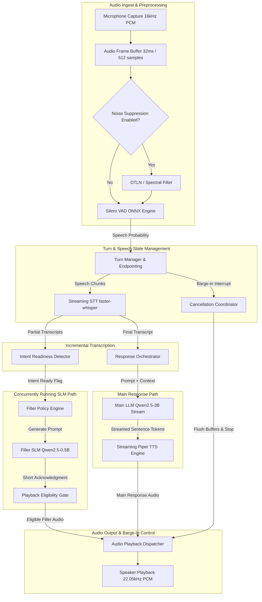
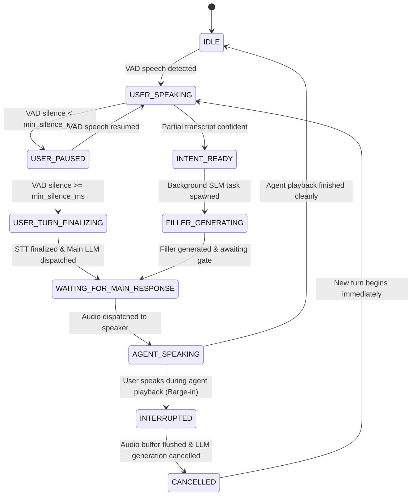

# System Architecture Specification

## 1. Executive Summary

This document specifies the modular architecture for the local-first, low-latency conversational voice agent. The system is designed to provide seamless, human-like voice interaction with sub-second perceived response latency, robust barge-in interruptibility, and predictive filler generation—all running locally on commodity CPU hardware without cloud dependencies.

---

## 2. End-to-End Pipeline & Data Flow

The architecture decouples audio ingestion, speech recognition, conversational intelligence, speech synthesis, and playback into asynchronous worker tasks communicating over bounded `asyncio.Queue` primitives.



---

## 3. The Dual-Track Orchestration Model

A traditional voice agent executes sequentially:
```
[User Speaks] ➔ [VAD Silence Delay: 500ms] ➔ [STT Finalize: 200ms] ➔ [LLM TTFT: 400ms] ➔ [TTS First Chunk: 150ms]
Total Perceived Latency = ~1250ms
```

Our architecture introduces a **Dual-Track Concurrent Model**:
1. **Track A (Incremental Intent & Predictive Filler):**
   - While the user is speaking, partial transcripts are emitted every 150–250ms.
   - The **Intent Readiness Detector** computes syntactic and semantic completeness heuristics.
   - When intent confidence exceeds threshold $\theta_{intent}$, a background task requests a micro-filler (e.g., *"Let's take a look..."*) from an ultra-lightweight SLM (0.5B parameters).
   - This generation latency is **hidden behind the user's trailing speech**.

2. **Track B (Main Response Pipeline):**
   - When the user finishes speaking (VAD endpoint triggered), the full prompt is immediately dispatched to the Main LLM (3B parameters).
   - The **Playback Gate** determines whether to play the pre-generated filler:
     - If the main LLM produces its first audio chunk faster than $\Delta t_{threshold}$, the filler is **discarded** without speaking.
     - If the main response is still generating, the filler is played to bridge the gap.
     - The main response is queued to start immediately after the filler ends.

---

## 4. Turn-Taking State Machine

The system manages conversation state across well-defined lifecycle states:



### State Definitions

| State | Trigger | Active Actions |
|---|---|---|
| `IDLE` | Pipeline initialized or previous turn completed. | Listening to microphone; running lightweight VAD frame evaluation. |
| `USER_SPEAKING` | VAD probability > threshold for $\ge N$ frames. | Accumulating audio into ring buffer; streaming to incremental STT. |
| `USER_PAUSED` | VAD detects silence, but duration < endpointing window. | Holding audio buffer open; waiting for speech continuation or timeout. |
| `INTENT_READY` | Intent detector flags partial transcript as actionable. | Spawning asynchronous filler task without halting STT. |
| `FILLER_GENERATING`| Intent trigger confirmed. | SLM streaming short acknowledgement; output held in memory gate. |
| `USER_TURN_FINALIZING` | Silence duration exceeds endpointing threshold (e.g. 500ms). | Finalizing STT; packaging conversation context into Main LLM prompt. |
| `WAITING_FOR_MAIN_RESPONSE`| Main LLM requested. | Awaiting Time-to-First-Token (TTFT) or streaming sentence boundary. |
| `AGENT_SPEAKING` | Audio chunks sent to soundcard. | Monitoring VAD for barge-in speech frames. |
| `INTERRUPTED` | VAD detects user speech while in `AGENT_SPEAKING`. | Emitting cancellation signal; immediately stopping audio stream. |
| `CANCELLED` | Active generation tasks aborted. | Purging audio output queues; recording barge-in latency metric. |

---

## 5. Barge-In & Cancellation Mechanism

To guarantee zero audible lag when the user interrupts:
1. **Low-Latency Audio Output Buffer:** Audio playback is fed via fixed-size chunks (e.g., 20ms–50ms buffers) through `sounddevice.OutputStream`.
2. **Cancellation Token:** Every agent turn generates an incrementing `turn_id` and an `asyncio.Event` cancellation token.
3. **Hardware Flush:** Upon barge-in confirmation (3 consecutive speech frames = ~96ms):
   - The playback stream is immediately stopped with `stream.abort()` to flush the OS soundcard buffer.
   - The active HTTP/WebSocket generation streams for both the LLM and TTS are cancelled with `.cancel()`.
   - Any stale filler or response audio in the output queue is dropped.

---

## 6. Monotonic Latency Checkpoints

To ensure all latency measurements are objective, all components record Python `time.perf_counter()` timestamps against a structured `TurnMetrics` record:

1. `t_audio_first_frame` — Earliest audio sample of user turn.
2. `t_speech_start` — VAD triggers `USER_SPEAKING`.
3. `t_stt_first_partial` — First partial text string emitted.
4. `t_intent_ready` — Heuristic/SLM flags intent readiness.
5. `t_filler_gen_start` — SLM task begins generation.
6. `t_filler_gen_done` — Filler audio rendered and buffered.
7. `t_user_turn_end` — VAD endpoint threshold reached.
8. `t_stt_final` — Final transcript finalized.
9. `t_main_llm_start` — Prompt dispatched to Main LLM.
10. `t_main_llm_first_token` — First token received from LLM stream (TTFT).
11. `t_main_llm_done` — Complete LLM response stream closed.
12. `t_tts_first_chunk_ready` — First audio buffer synthesized.
13. `t_agent_first_audio_played` — First audible sample sent to speaker DAC.
14. `t_main_answer_first_audio` — First sample of actual answer played.
15. `t_interruption_detected` — User speech detected while agent playing.
16. `t_playback_cancelled` — Soundcard output silenced.

### Primary KPI Formulas
- **Perceived Response Latency:** $L_{perceived} = t_{agent\_first\_audio\_played} - t_{user\_turn\_end}$
- **Main Response Latency:** $L_{main} = t_{main\_answer\_first\_audio} - t_{user\_turn\_end}$
- **Barge-In Cutoff Latency:** $L_{barge\_in} = t_{playback\_cancelled} - t_{interruption\_detected}$
